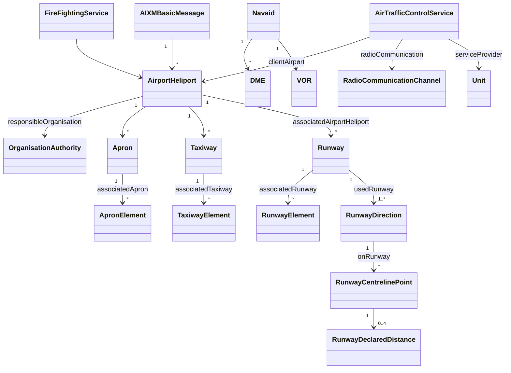

# HUEN — AIXM 5.1.1 aerodrome data set

An **AIXM 5.1.1** model of Entebbe International Airport (HUEN / EBB), generated
from a single YAML source of truth, validated against the official AIXM
schemas, and cross-checked against the flight tracks in this repository.

```bash
cd aixm
pip install -r requirements.txt
make            # build -> crosscheck -> validate
```

Output:

| file | what |
|---|---|
| `out/HUEN_AIP_DS.xml` | the AIXM 5.1.1 `AIXMBasicMessage` — 40 AIXM objects |
| `out/HUEN_validation_report.md` | schema result, domain checks, provenance table, cross-check |
| `out/track_crosscheck.json` | machine-readable cross-check results |
| `out/build_manifest.json` | per-object provenance emitted by the builder |

> **Not official AIS data.** This is an analysis-grade model assembled from open
> sources reachable from the build environment. The Uganda CAA AIP, AD 2 HUEN,
> remains authoritative. Nothing here may be used for navigation, flight
> planning or operations.

---

## 1. What is modelled

Everything in the message is a real AIXM 5.1.1 feature with a BASELINE time
slice, deterministic `gml:id` (UUIDv5, so rebuilds are stable), a `gml:validTime`
and a provenance annotation.



Concretely:

| group | objects |
|---|---|
| Aerodrome | `AirportHeliport` (designator, name, IATA, JOINT control type, field elevation, magnetic variation, ARP, served city, H24 availability), `OrganisationAuthority` (operator, `AirportHeliportResponsibilityOrganisation` role OPERATE) |
| Runways | 2 × `Runway` (17/35, 12/30) with nominal length/width and surface; 2 × `RunwayElement` pavement outline; 4 × `RunwayDirection` with true/magnetic bearing, approach marking, precision approach; 4 × `RunwayCentrelinePoint` carrying THR positions; 16 × `RunwayDeclaredDistance` (TORA/TODA/ASDA/LDA for all four directions) |
| Movement area | 4 × `Taxiway` + 4 × `TaxiwayElement`; 2 × `Apron` + 2 × `ApronElement` |
| Radio navigation | `Navaid` NN (VOR/DME, 117.500 MHz, DME 122X) with `VOR` + `DME` equipment; 2 × `NDB` (EM 355 kHz, PB 270 kHz) |
| Communications | 4 × `RadioCommunicationChannel` (TWR 118.100, APP 126.600, ACC 128.500, and the conflicting DAFIF APP 119.100) |
| Services | 2 × `AirTrafficControlService` (TWR, APP) with `Unit` providers; `FireFightingService` RFF CAT A9 |

Declared distances are attached to the point they are measured **from**, per
PANS-AIM and the AIXM coding guidance: TORA/TODA/ASDA to the `START_RUN` role,
LDA to the `THR` role.

## 2. Layout

```
aixm/
├── data/huen.yaml            # the only input: every fact + its provenance
├── scripts/
│   ├── build_aixm.py         # YAML -> AIXM 5.1.1 BasicMessage + manifest
│   ├── validate_aixm.py      # XSD + domain checks -> markdown report
│   └── track_crosscheck.py   # AIXM geometry vs tracks/ ground positions
├── schema/
│   ├── aixm-5.1.1/           # official AIXM 5.1.1 XSDs (AIXM_Features, GML, ISO 19139)
│   └── xlink/                # required by AIXM_Features.xsd (relative import)
└── out/                      # generated: do not hand-edit
```

`data/huen.yaml` is the source of truth. Nothing in `out/` should be edited by
hand — change the YAML and rebuild.

## 3. How the YAML works

Plain scalars inherit the `_source` of their block; use a mapping to override a
single value, add a note, or change its confidence:

```yaml
runways:
  - designator: "12/30"
    _source: ourairports                 # default for this runway
    nominal_length_m: {value: 2408, source: dafif, confidence: published}
    ends:
      "12":
        declared:
          LDA: {value: 1748, source: chart, confidence: assumed,
                note: "LDA 1748 m vs TORA 2400 m with no published displaced threshold."}
```

**Confidence** is the important field:

| confidence | meaning |
|---|---|
| `published` | a source states this value directly |
| `derived` | computed by the build (e.g. a runway outline buffered from threshold coordinates, or apron envelopes taken from observed ground tracks) |
| `assumed` | a judgement call where sources conflict or are silent — always reported |

Every object whose confidence is not `published` carries an `aixm:annotation`
recording exactly that, so the provenance travels inside the data set rather
than only in a report.

## 4. Validation

Two independent layers, because a schema cannot tell you that a TORA exceeds its
runway.

**Schema.** The message is validated against `schema/aixm-5.1.1/message/AIXM_BasicMessage.xsd`
and everything it imports (AIXM features and data types, GML 3.2.1, ISO 19139,
xlink). A pass means the document is a legal AIXM 5.1.1 BasicMessage — element
order, codelist values, union types and geometry structure all conform. This is
the same schema set AIXM tooling compiles against, vendored so validation works
offline.

**Domain.** `validate_aixm.py` adds checks the schema cannot express:

- every `xlink:href` resolves to an object in the message, and every `gml:id` is unique
- BASELINE conventions (one time slice, `interpretation`, `validTime`, `sequenceNumber`)
- published runway length vs the geodesic distance between threshold coordinates
- published `trueBearing` vs the geodesic bearing between the thresholds, and
  reciprocal directions differ by 180°
- TORA ≤ runway length; TODA/ASDA ≥ TORA; LDA ≤ TORA; **LDA < TORA with no
  `DISTHR`** is flagged
- thresholds must lie on the runway pavement outline
- aerodrome magnetic variation vs the declination implied by the published
  true/magnetic runway bearings
- surface rings are closed, non-zero area; taxiway geometry width ≈ declared width
- NDB frequencies inside the MF band, DME channel format, VHF frequency sanity
- every derived/assumed object carries a provenance annotation

Findings are graded **ERROR** (internally inconsistent — must fix), **WARN**
(sources conflict or the value needs the AIP), **INFO**. The script exits
non-zero on schema failure or any ERROR, so it works as a CI gate; see
`.github/workflows/aixm-validate.yml`.

Current state: **schema PASS, 0 errors, 2 warnings**, both genuine data
conflicts described below.

## 5. Cross-check against the flight tracks

The repository already holds 350 FR24 tracks. `track_crosscheck.py` reads the
AIXM geometry back out of the generated XML and compares it with every
ground-level position (altitude < 60 ft within 25 km of the ARP) — 332 flights
have usable data. It answers questions the schema cannot:

- **Runway centrelines agree with reality.** 3,026 ground points lie within 30 m
  of the 17/35 centreline with a median lateral offset of 15 m, and 301 on
  12/30 at 15 m. The published threshold coordinates and bearings describe the
  pavement aircraft actually use.
- **Direction of operation.** All 332 flights used runway 17/35; 146 arrivals and
  143 departures in the 17 direction, 20 and 16 in the 35 direction. Runway
  12/30 never appears as the runway in use, although 100 flights taxi close
  enough to register points on its centreline — departures from the apron are
  taxiied **across** the 12 threshold area to reach 17/35.
- **Intersection departures.** Line-ups in the 17 direction sit a median 381 m
  past the threshold rather than at it, i.e. aircraft line up at an
  intersection; in the 35 direction they line up 16 m from the threshold.
- **The derived apron/taxiway network is incomplete, and says so.** 26% of
  observed ground movement falls outside every modelled surface, because
  aircraft use links, holding bays and stand taxilanes that no accessible
  source describes. That number is the honest measure of what the geometry
  covers.

## 6. Known gaps

Absent because no accessible source states them — each is a candidate for the
next iteration:

- **ILS**: DAFIF reports ILS on runway 17, but the ident, frequency and
  glidepath geometry were unavailable, so no `Localizer`/`Glidepath` is encoded
  (only `precisionApproachGuidance = ILS_PRECISION_CAT_I` is recorded, flagged
  as assumed).
- **Obstacles** (`VerticalStructure`) and terrain: no open obstacle survey.
- **Reduced/intersection declared distances**: only full-length values are published.
- **Taxiway designators, holding positions, markings, lighting**: the taxiway
  network is geometric only. Designators were omitted rather than invented.
- **Aircraft stands** (`AircraftStand`): stand designators/positions unavailable.
- **Operating hours as a timesheet**: AIXM 5.1.1 `AirportHeliportAvailability`
  has no time interval, so H24 is carried as an annotated statement.

Two warnings worth knowing about:

1. **RWY 12 LDA vs TORA.** Published TORA is 2400 m but LDA is 1748 m, a 652 m
   difference, with no displaced threshold stated. The value is encoded as
   published and flagged, rather than inventing a `DISTHR` position.
2. **RWY 12/30 length.** The threshold coordinates in the open data imply
   2446 m against a published 2408 m. The coordinates are rounded to ~11 m, so
   this is a source-precision artefact; it is reported, not silently smoothed.

Magnetic variation is also genuinely uncertain (sources give 0.0°, 1.4°E, 1.7°E,
and the published magnetic bearings imply ~2°E). The model carries 1.0°E with a
0.7° accuracy and the conflict is documented — see §5 below.

## 7. Extending

**Another airport.** Copy `data/huen.yaml`, change the identifiers, thresholds
and navaids, then:

```bash
python scripts/build_aixm.py --data data/other.yaml --out out/OTHER_AIP_DS.xml
```

**A new feature type.** Add a `build_*` function in `build_aixm.py` that takes the
`Ctx`, creates the feature with `ctx.feature(key, "FeatureName", "FeatureNameTimeSlice")`,
and — this is the part that matters — emits properties in the exact order of the
AIXM property group (they are `xsd:sequence`s). Register a `ctx.record(...)` call
so the object appears in the provenance table. AIXM 5.1.1 also permits
`aixm:extension` blocks for non-standard attributes if you need them.

**Towards a real AIP data set.** Replace each `assumed` value with the published
one, fill in the gaps in §6, and start a new baseline by changing
`dataset.effective`. The message is a BASELINE only; TEMPDELTA and PERMDELTA
slices (the digital-NOTAM mechanism) are not modelled.

## 8. Provenance of the sources

| id | source | used for |
|---|---|---|
| `ourairports` | [OurAirports open data](https://github.com/davidmegginson/ourairports-data) | threshold coordinates, headings, elevations, navaid positions, some frequencies |
| `dafif` | DAFIF figures as republished (Airports Worldwide, SkyVector) | runway dimensions, ILS presence, APP 119.1 |
| `chart` | HUEN aerodrome chart extract | declared distances, RFF category, H24 hours |
| `tracks` | this repository's `tracks/` | taxiway offset, apron envelopes, cross-checks |
| `wmm` | World Magnetic Model estimate | magnetic variation |

The AIXM 5.1.1 schemas in `schema/` are © EUROCONTROL & FAA, redistributed under
the BSD-style licence reproduced in their header, unchanged apart from location.
